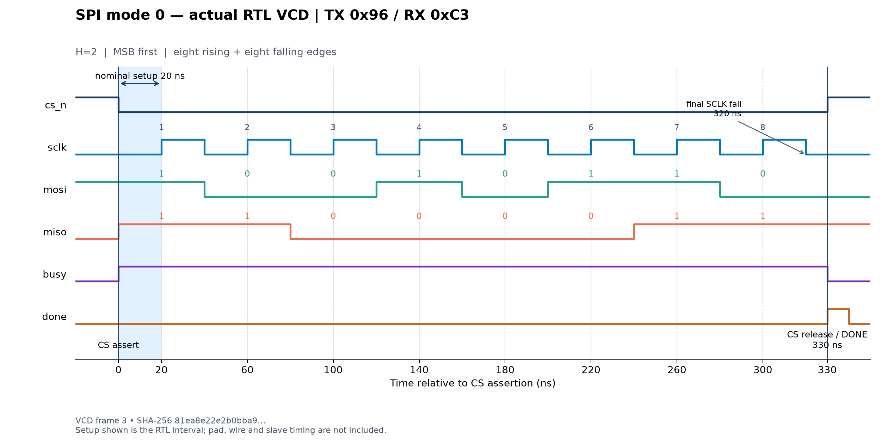

# Báo cáo cải tiến H03 — Chủ SPI chế độ 0

Ngày thực hiện: 25/10/2026. Nguồn đầu vào là gói H03_Chu_SPI_che_do_0.zip do người dùng cung cấp. Phạm vi bài H03/B2 đối chiếu với [phiếu đề đã lưu](REFERENCE_CHARTER_H03.html). Các kết quả đo, công cụ và đường dẫn run hiện hành nằm trong [RESULTS.md](RESULTS.md).

## 1. Bài toán và vị trí trong hệ thống

Khối SPI master nhận một byte từ khối điều khiển, phát xung SCLK và tín hiệu chọn slave CS_n, đồng thời truyền MOSI và thu MISO. Một ứng dụng phù hợp là trao đổi một byte với thanh ghi ngoại vi có giao thức cho phép mỗi byte là một frame CS riêng. Các giao dịch command/address/data nhiều byte yêu cầu giữ CS liên tục chưa được hỗ trợ.

Đầu vào host gồm START và TX byte; đầu ra host gồm BUSY, DONE và RX byte. Host chỉ phát yêu cầu khi IDLE, giữ dữ liệu hợp lệ tại cạnh nhận lệnh và đọc RX khi DONE. Với host khác miền clock, cần thiết kế cầu bắt tay/đồng bộ riêng. Khối hiện tại giả định host đồng bộ với clk.

## 2. Những thiếu sót đã xử lý

Gói cũ có cấu trúc tài liệu tốt nhưng trộn trạng thái dự kiến và số đo lịch sử. Testbench ban đầu không đủ để khẳng định đầy đủ MOSI, byte RX và pha xung; sự tồn tại của file assertion chưa chứng minh assertion đã được chạy. Một số mục mô tả reset như bất đồng bộ, dù RTL reset tại cạnh lên clk. Tài liệu cũng gọi flow vật lý là tự chọn, khác với phiếu B2 hiện có.

Bản cải tiến thống nhất yêu cầu/đặc tả/kiến trúc với RTL, bổ sung kiểm chứng độc lập trên chân SPI và tạo lại bằng chứng từ nguồn được chốt. Mọi PASS của báo cáo kết quả có log, mã thoát, cấu hình, hash nguồn và artifact tương ứng. Log lịch sử được đặt riêng.

RTL thêm ba thay đổi có phạm vi hẹp: từ chối H<1; so sánh bộ chia bằng hằng cùng độ rộng; nhánh default FSM hủy frame về bus idle, không phát DONE và giữ byte RX hoàn tất gần nhất. Mô phỏng fault injection kiểm nhánh phục hồi RTL. Điều đó không tự chứng minh khả năng chịu lỗi phần cứng hay phục hồi mọi upset sau mã hóa lại FSM.

Wrapper Tiny Tapeout giải quyết xung đột trong map đề: uio[0] và uio[1] không thể vừa làm đầu vào START/MISO vừa phát RX. Map mới dùng uo[7:3] cho RX[4:0], uio[4:2] cho RX[7:5], uio[5:6] cho BUSY/DONE; `uio_oe=0x7c`. Tổng dùng 23/24 chân người dùng. clk/rst_n/ena là cổng hạ tầng riêng.

## 3. Kiến trúc và hợp đồng theo chu kỳ

Lõi có FSM IDLE–TRANSFER–FINISH, thanh ghi TX dịch, thanh ghi RX dịch, thanh ghi RX kết quả, bộ đếm nửa chu kỳ và bộ đếm số lần lấy mẫu. Tất cả thanh ghi dùng clk hệ thống; không dùng SCLK làm clock nội bộ. Wrapper chỉ nối lại các chân và chặn nhận START mới khi ena=0.

Ở cạnh nhận START, TX được chốt, CS_n xuống thấp, BUSY lên cao và bit MOSI đầu tiên được đưa ra. CPOL=0 giữ SCLK thấp khi idle. CPHA=0 yêu cầu bit đầu có trước cạnh SCLK lên đầu tiên. Các bit MOSI tiếp theo đổi ở cạnh xuống; MISO được lấy mẫu tại sự kiện clk tạo cạnh SCLK lên.

Gọi E(0) là cạnh clk chấp nhận lệnh, H=HALF_CYCLES:

| Sự kiện | Chu kỳ tương đối |
|---|---:|
| CS_n hạ, MOSI bit đầu, BUSY=1 | 0 |
| Cạnh lên lấy mẫu thứ k, k=1…8 | (2k−1)H |
| Cạnh xuống thứ k, k=1…8 | 2kH |
| Nhả CS_n, cập nhật RX, DONE=1, BUSY=0 | 16H+1 |
| Nhận frame tiếp nếu START còn cao | 16H+2 |

DONE rộng một chu kỳ clk. RX không thay đổi trong frame hay idle, chỉ cập nhật khi hoàn tất, hoặc xóa khi reset. Reset đồng bộ có ưu tiên cao nhất và hủy frame. START trong lúc BUSY không được xếp hàng. Giữ START cao sẽ lặp lại frame khi IDLE; đây là giao diện theo mức, cần lưu ý khi nối nút bấm hay phần mềm.

Với clk 100 MHz và H=4, SCLK danh định 12,5 MHz, độ trễ START→DONE là 65 chu kỳ =650 ns. Đây là quan hệ logic; tần số sử dụng thực tế còn phụ thuộc ngân sách timing của slave và đường nối.

## 4. Phương pháp kiểm chứng

Regression dùng slave độc lập: nạp bit MISO đầu khi CS hạ, đổi bit tiếp tại cạnh xuống SCLK. Checker đọc chân sau cập nhật nonblocking, kiểm MOSI từng bit, đủ tám cạnh lên/tám cạnh xuống, chu kỳ bộ chia, CS bao toàn frame, byte RX, độ rộng DONE và giá trị idle. TX đầu vào được cố ý thay sau nhận lệnh để kiểm dữ liệu đã chốt.

Ma trận H=1,2,3,4,5,8 × MSB/LSB có 6.320 ca. Mỗi cấu hình có đủ 256 giá trị byte ở mỗi chiều, 128 cặp giả ngẫu nhiên với seed cố định, các ca START trong BUSY/FINISH, START giữ cao, reset ở toàn bộ vị trí theo chu kỳ và frame phục hồi. Đây không phải vét cạn toàn bộ 65.536 cặp TX/RX.

Hai ca biên quan trọng là H=1 để bắt lệch pha bộ chia và reset ngay trước hoàn tất để bắt DONE giả hoặc CS không nhả. Các byte bất đối xứng 01/80 và 96/C3 bắt đảo thứ tự bit mà 00/FF có thể che. Mutation ép RX=0, ép bit MOSI đầu=0 và kết thúc sau bảy bit phải làm checker thất bại. Việc các mutation bị phát hiện bổ sung bằng chứng rằng testbench có kiểm dữ liệu và số bit.

Wrapper có 78 ca riêng trên sáu cấu hình, dùng mô hình pad tri-state để kiểm OE và không tranh chấp START/MISO. ENA được đổi cả lúc idle và giữa frame; frame đã nhận phải hoàn tất. Netlist sau route được chạy lại bằng model cell sky130 ở chế độ chức năng, với 532 ca lõi và 13 ca wrapper tại cấu hình được harden H=4/MSB.

EQY so RTL với netlist sau route. Script nhập model formal sky130, flatten thiết kế và chứng minh mọi partition đầu ra bằng SAT/PDR; không loại đầu ra hay đổi nghĩa reset. Script này thay tích hợp EQY mặc định gặp lỗi thừa blackbox của LibreLane 3.0.16. Mô phỏng gate không chú thích SDF; timing sau route được kiểm bằng STA riêng.

## 5. Waveform lấy từ lần chạy thật

Frame minh họa gửi 0x96, thu 0xC3, H=2, clk chu kỳ 10 ns. Cạnh lên nằm tại 20,60,…,300 ns; cạnh xuống tại 40,80,…,320 ns; CS nhả và DONE xuất hiện tại 330 ns sau khi CS hạ. Có đủ tám xung, MOSI/MISO cho hai byte khác nhau. Script trích trực tiếp tên/identifier từ VCD, kiểm mẫu bit và các mốc thời gian trước khi vẽ.

Mô hình Python dự đoán độc lập sự kiện chân theo công thức giao thức. Bản so sánh VCD–oracle lưu hash và năm phép đối chiếu. Self-check mô hình Python được báo riêng, không dùng thay kết quả kiểm RTL.

## 6. Flow vật lý và đóng timing

Pipeline chạy Verilator lint, Yosys synthesis, STA trước P&R, floorplan, đặt cell, CTS, đi dây, trích RC, STA chín corner, stream-out Magic/KLayout, XOR, DRC hai công cụ và LVS. Sau đó chạy equivalence và mô phỏng netlist. Runner chỉ đánh PASS khi các metric cần thiết có mặt và số vi phạm bằng không; mã thoát 0 của LibreLane riêng lẻ chưa đủ.

Điều kiện phân tích: clk 10 ns, uncertainty 0,25 ns, input transition 0,15 ns, input/output delay min/max 0,2/1 ns, tải đầu ra 0,033442 pF, max transition 0,75 ns. Reset đồng bộ vẫn được timing, không false-path. PDK sky130A, thư viện sky130_fd_sc_hd, LibreLane 3.0.16. Synthesis và placement có thể dùng số cell khác nhau vì CTS, buffer, tap và filler được thêm sau synthesis; báo cáo kết quả tách các số đó.

Lần đầu đạt DRC/LVS/setup/hold nhưng có 30 vi phạm slew trên mạng reset, worst 0,751037 ns so giới hạn 0,750 ns. Việc chỉ bật thêm corner và post-route repair chưa giải quyết hoàn toàn. Bản đóng timing thêm ràng buộc fanout 8 cho mạng điều khiển để resizer tạo cây đệm, vẫn giữ nguyên tải/slew/delay/clock. Kết quả cuối phải đọc theo từng top trong RESULTS, cùng các log failed iteration được lưu để giải thích quá trình tối ưu.

## 7. Diễn giải và giới hạn

Slack dương trong bộ SDC này chứng minh timing khối đạt các giả định đã ghi. Nó chưa chứng minh timing toàn vòng SCLK→slave→MISO qua PCB, pad và đặc tính slave. Trước tích hợp phải tính SCLK-to-MISO, skew, setup/hold và yêu cầu MOSI/CS từ datasheet cụ thể. Đồng bộ MISO tùy tiện có thể làm thay đổi pha lấy mẫu.

GDS/DRC/LVS của macro không thay kiểm harness/tile Tiny Tapeout, padframe, sign-off foundry hay đo silicon. Chưa thiết kế FIFO, bus thanh ghi, giao dịch nhiều byte/CS, SPI mode khác hoặc nhiều slave. Công suất do STA ước lượng theo activity giả định, không là số đo công suất bằng workload thực. IR drop thiếu vị trí cấp nguồn hệ thống chỉ có giá trị tham khảo ở mức macro.

Các workflow GitHub đã được chuẩn bị. Chỉ ghi CI đã chạy khi có repo, commit và run URL thật; tình trạng truy cập hiện tại được ghi trong RESULTS. Bộ hồ sơ không gán log local thành log CI.

## 8. Tài liệu đối chiếu

- [Charter H03/B2 lưu cùng dự án](REFERENCE_CHARTER_H03.html).
- [Cấu hình thiết kế LibreLane](https://librelane.readthedocs.io/en/latest/reference/configuration.html).
- [Các bước, kiểm tra và biến cấu hình](https://librelane.readthedocs.io/en/latest/reference/step_config_vars.html).
- [Classic flow](https://librelane.readthedocs.io/en/latest/reference/flows.html).
- [Nhật ký sửa yêu cầu, đặc tả và tài liệu](CHANGE_AUDIT.md).
