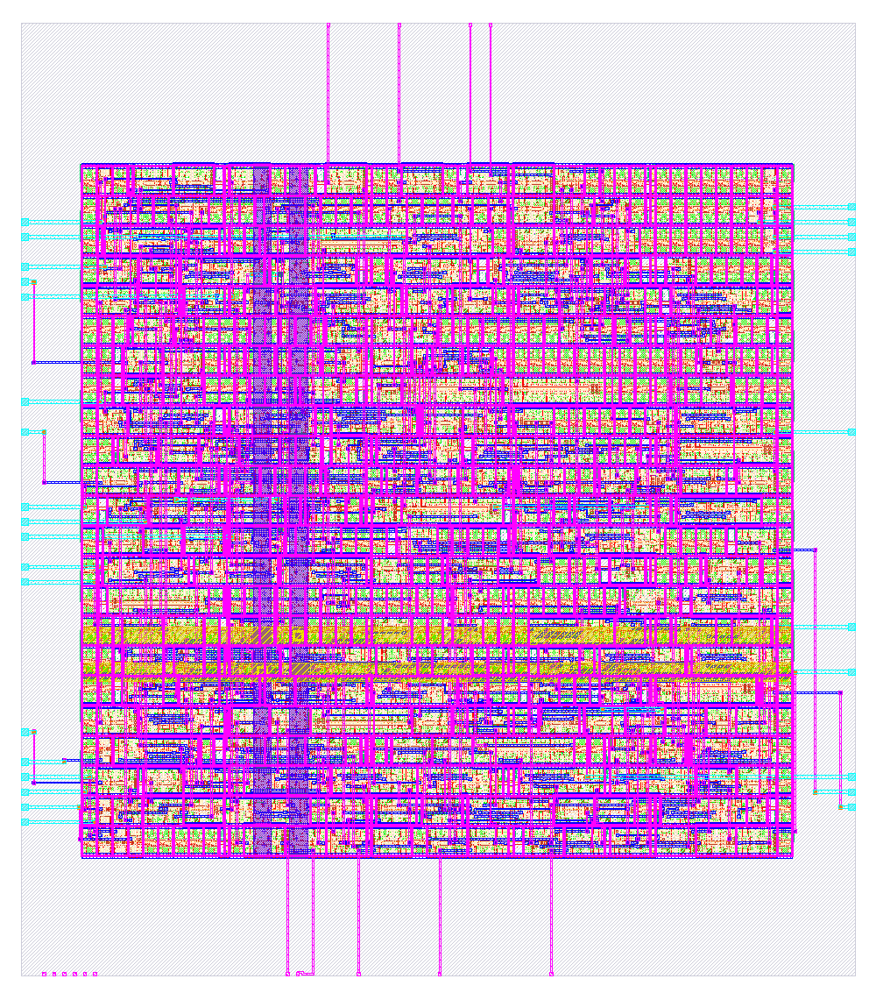

# Kết quả thực chạy H03 SPI mode 0

Hoàn tất: **25/10/2026 14:29:45 UTC+7**. Trạng thái pipeline cục bộ: **PASS**.

Nguồn trạng thái: [summary.json](../evidence/full_flow_final/summary.json). Mọi stage dưới đây có mã thoát 0, output mới và hash nguồn đầu vào. Các run thất bại trước đó được lưu riêng, không dùng làm kết quả cuối.

| Bước | Kết quả |
|---|---|
| Regression lõi, 12 cấu hình | PASS · 6,320 ca; 5,548 frame hoàn chỉnh, 772 reset-abort |
| Probe phục hồi FSM / từ chối H=0 và H=−1 | 3/3 đạt; hai tham số sai bị từ chối đúng kỳ vọng |
| Mutation RX=0 / MOSI bit đầu=0 / frame 7 bit | 3/3 bị checker phát hiện |
| Regression wrapper, 6 cấu hình | PASS · 78 ca |
| VCD so mô hình sự kiện độc lập | PASS · 5 đối chiếu trên frame 96/C3/H=2 |
| RTL→GDSII lõi và wrapper | PASS · cả hai top |
| Equivalence RTL–netlist sau route | EQY PASS · cả hai top |
| Mô phỏng netlist sau route | PASS · lõi 532 ca; wrapper 13 ca, H=4/MSB |

256 byte mỗi chiều đã được phủ trong từng cấu hình; không phải vét cạn mọi cặp TX/RX. Mô phỏng netlist dùng model chức năng, không chú thích SDF. EQY là chứng minh tuần tự logic; STA kiểm timing riêng.

## Kết quả vật lý mới

Cấu hình harden H=4/MSB, clock 10 ns, sky130A/sky130_fd_sc_hd. Setup/hold worst slack là giá trị tổng hợp tệ nhất trong chín corner STA.

| Chỉ số | Lõi SPI | Wrapper Tiny Tapeout |
|---|---:|---:|
| Cell sau synthesis | 126 | 144 |
| Flip-flop sau route | 37 | 37 |
| Standard cell sau route | 264 | 282 |
| Diện tích standard cell (µm²) | 2656.30 | 2738.88 |
| Diện tích die macro (µm²) | 6268.49 | 6527.41 |
| Worst setup slack (ns) | +2.783307 | +3.618669 |
| Worst hold slack (ns) | +0.108442 | +0.111286 |
| Setup / hold violations | 0 / 0 | 0 / 0 |
| Slew / cap violations | 0 / 0 | 0 / 0 |
| Magic / KLayout DRC | 0 / 0 | 0 / 0 |
| LVS / GDS XOR | 0 / 0 | 0 / 0 |
| Antenna nets / pins | 0 / 0 | 0 / 0 |
| Power total từ metrics (mW, ước lượng) | 0.542798 | 0.530224 |

Synthesis cell, standard cell và tổng instance gồm filler/tap là các cách đếm khác nhau. Không dùng các bảng này để tuyên bố giảm PPA so với run lịch sử có SDC khác. Power là metric ước lượng theo activity của công cụ, không phải đo thực hoặc kết quả switching từ workload SPI thực.

Lần cuối khắc phục vi phạm slew reset bằng giới hạn fanout 8; không nới giới hạn chuyển mức 0,75 ns. Chi tiết quá trình và lỗi tích hợp EQY trong [báo cáo](BAO_CAO_CAI_TIEN.md).

## Tệp để đối chiếu

- **h03_spi_master**: [GDS](../flow/runs/closure_20261025_core/final/gds/h03_spi_master.gds), [netlist](../flow/runs/closure_20261025_core/final/nl/h03_spi_master.nl.v), [metrics](../flow/runs/closure_20261025_core/final/metrics.json), [flow log](../evidence/full_flow_final/physical_core.log), [EQY](../evidence/full_flow_final/equivalence_core/summary.json), [gate sim](../evidence/full_flow_final/gate_sim_core/summary.json).
- **tt_um_h03_spi_mode0**: [GDS](../flow/runs/closure_20261025_wrapper/final/gds/tt_um_h03_spi_mode0.gds), [netlist](../flow/runs/closure_20261025_wrapper/final/nl/tt_um_h03_spi_mode0.nl.v), [metrics](../flow/runs/closure_20261025_wrapper/final/metrics.json), [flow log](../evidence/full_flow_final/physical_wrapper.log), [EQY](../evidence/full_flow_final/equivalence_wrapper/summary.json), [gate sim](../evidence/full_flow_final/gate_sim_wrapper/summary.json).
- [CSV từng ca lõi](../evidence/full_flow_final/rtl_regression/test_results.csv), [CSV wrapper](../evidence/full_flow_final/wrapper_regression/test_results.csv).
- [VCD waveform](../evidence/full_flow_final/rtl_regression/hc2_order1/sample_mode0.vcd), [đối chiếu mô hình](../evidence/waveform_oracle_comparison.json).
- [Lần đầu vi phạm slew](../evidence/iterations/initial_slew/checks.rpt), [lỗi combine script EQY mặc định](../evidence/iterations/generic_eqy/combine.log).

## Công cụ và provenance

LibreLane **3.0.16**, PDK sky130 **8afc8346a57fe1ab7934ba5a6056ea8b43078e71**. Phiên bản từng tool có log trong evidence/full_flow_final. Snapshot nguồn dùng khi chạy nằm trong evidence/full_flow_final/inputs; raw logs giữ đường dẫn gốc của máy chạy để không làm sai provenance.

Hash RTL cải tiến: `f89a7f3f8a82516cbfbcb3900456454f95dbcb584e6be29e4158409c0321214e`.

## Giới hạn và GitHub

Flow đã hoàn tất tại máy qua Ubuntu WSL. Kết nối GitHub xác thực tài khoản cfm1582006-tech và installation chọn all repositories, nhưng API trả danh sách repo trống. Chưa tạo repo, commit, pull request hoặc run GitHub Actions. Computer Use dừng vì không xác định chắc URL Edge; không tiếp tục thao tác trình duyệt. Workflow simulation và physical đã có trong .github/workflows; physical cần runner EDA đã cấu hình.

Các cảnh báo còn lại trong log gồm library được đọc lại, quy tắc LEF chưa được OpenROAD hỗ trợ, thiếu vị trí nguồn cho IR drop, và các chân input dự phòng không có antenna gate. DRC cuối được kiểm bằng cả Magic/KLayout; các cảnh báo này vẫn được giữ. Macro này chưa phải bản tích hợp harness/tile Tiny Tapeout hoặc sign-off chế tạo.

Đã rà phần nguồn/tài liệu đối với mục giống ảnh người dùng gửi: không tìm thấy mục tương ứng cần xóa. Chi tiết ở CHANGE_AUDIT.md.
